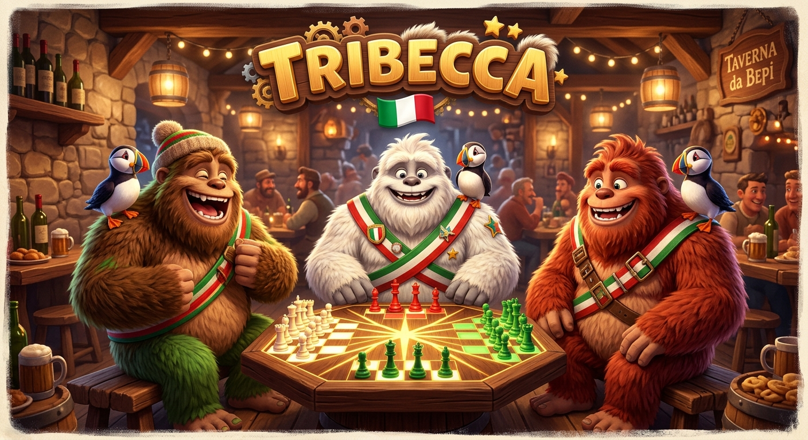
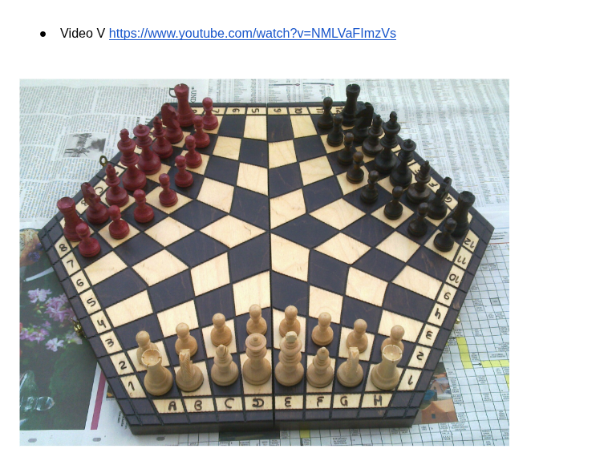

# 🇮🇹♟️🔺 TriBecca — Scacchi Tricolore 3D a 3 Giocatori

> ### 🌐🚀 **[GIOCA SUBITO LIVE SU GITHUB PAGES → `https://palladius.github.io/tribecca/`](https://palladius.github.io/tribecca/)**

<p align="center">
  
</p>

Un gioco didattico e pragmatico di **Scacchi a 3 Giocatori (3D + 2D)** ispirato a [`carchess3d`](https://github.com/palladius/carchess3d), progettato per insegnare ad **Alessandro (8 anni)** e **Sebastian (6 anni)** a padroneggiare le regole e le traiettorie della scacchiera esagonale in legno a **96 caselle (`A..L` × `1..12`)** di casa Carlesso!

---

## ✨ Caratteristiche Principali

1. **🔦 Killer Feature — Illuminazione Raggi che si Dipartono (`MoveRayHighlighter` 2D & 3D)**:
   - Cliccando su qualsiasi pezzo (anche avversario!), la scacchiera illumina l'intero albero di **fasci luminosi continui** che partono dal pezzo, mostrando visivamente come le traiettorie curvano sui confini di settore e **si biforcano a Y attraverso la Rosetta centrale (`D4, D5, I5, I9, E9, E4`)**:
     - **🟡 Giallo Oro**: Raggi ortogonali e diagonali standard (incluse le deflessioni esterne `[00:58]`).
     - **🔵 Ciano Elettrico (`✳️`)**: Raggi diagonali che attraversano il vertice centrale della Rosetta mantenendo il colore della casella (`[00:48]`).
     - **🟣 Viola Magico**: Salti a `L` ($2+1$) del Cavallo che girano attorno alla Rosetta (`[02:36]`).
     - **🔴 Rosso Corallo**: Catture legali.
     - **🚫 Divieto Cambio Colore nella Rosetta (`[01:15]`, `[01:22]`)**: Indica visivamente la casella diametralmente opposta di colore diverso vietata a Re, Regina e Alfiere (`D4 ↔ I9`, `E4 ↔ I5`, `D5 ↔ E9`).
2. **🔄 Rotazione Automatica di $120^\circ$ a Ogni Mossa**:
   - Turnazione oraria **⚪ Bianco ($0^\circ$) $\rightarrow$ 🔴 Rosso ($120^\circ$) $\rightarrow$ 🟢 Verde ($240^\circ$)** con rotazione fluida della telecamera 3D e toggle `🇮🇹 Tema Tricolore` ⇄ `🪵 Tema Legno Vera`.
3. **🐧 `PuffinLogin` & Tutte le Combinazioni (`1v2`, `2v1`, `3v0`, `0v3 Auto-Play`)**:
   - Abbinamento diretto tra ciascuno dei 3 colori (`⚪ Bianco`, `🔴 Rosso`, `🟢 Verde`) e i profili di famiglia (`🦖 Papino Riccardo`, `🐉 Ale`, `🐴 Seby`, `👸 Mamma Kate`, `👵 Nonna Lucilla`, `🐧 Ospite`, `🤖 Computer`).
   - Include la modalità **`🍿 Gioca da Solo (3 🤖)`** con controlli `Pausa/Play`, `1 Mossa CPU` e selettore di velocità.
4. **💥 Le 4 Modalità di Eliminazione / Scacco Matto**:
   - **`1. Distruzione (Default)`**: Rimuove i pezzi dello sconfitto e gli altri 2 continuano.
   - **`2. Assimilazione (Protoss Conquer)`**: Chi dà scacco matto eredita i pezzi superstiti dello sconfitto.
   - **`3. Relitti Inerti (Flotsam)`**: I pezzi dello sconfitto restano immobili come ostacoli catturabili che non muovono e non danno scacco.
   - **`4. Morte Improvvisa (Sudden Death)`**: Il primo scacco matto chiude subito la partita.
5. **🛠️ Specchio della Scacchiera Vera (`Board Editor`) & `Undo/Redo` Illimitato**:
   - Copia al volo qualsiasi posizione dalla scacchiera di legno sul tavolo per verificare dove arrivano i raggi di ogni pezzo!

<p align="center">
  
</p>

---

## 🚀 Quickstart

```bash
just test    # Esegue i test unitari headless su topologia 96 caselle e regole della Rosetta
just serve   # Avvia il server locale su http://localhost:8080
```

- 📐 **Specifica Completa**: [`docs/spec/SPEC.md`](docs/spec/SPEC.md)
- 🎥 **Video Regolamento**: [`https://www.youtube.com/watch?v=NMLVaFImzVs`](https://www.youtube.com/watch?v=NMLVaFImzVs)
